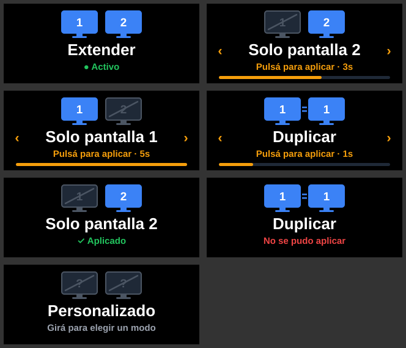

# Display Switch para Redragon SS-552 / StreamDock

Plugin para las perillas de la **Redragon SS-552 Ragnaros** (y otros dispositivos compatibles con **StreamDock**) que cambia el modo de pantalla de Windows, igual que **`Win + P`**:

- **Solo pantalla 1**
- **Duplicar**
- **Extender**
- **Solo pantalla 2**



## Cómo se usa

| Acción | Resultado |
|---|---|
| **Girar** la perilla | Recorre los cuatro modos (en ciclo). La pantalla muestra el modo elegido en ámbar con una cuenta regresiva |
| **Pulsar** la perilla | Aplica el modo elegido y muestra "✓ Aplicado" |
| **No pulsar** en 5 segundos | No cambia nada y la pantalla vuelve al modo activo |
| Volver a girar hasta el modo activo | Cancela la selección |
| Cambiar el modo con `Win + P` | La perilla se actualiza sola en unos segundos |

Los monitores dibujados indican qué pantallas quedan encendidas: en azul las que se usan, tachadas las que Windows deja de usar.

## Cómo funciona

El plugin es un ejecutable en **Go** (`displayswitch.exe`) que StreamDock inicia y con el que se comunica por WebSocket (protocolo del SDK de StreamDock / Stream Deck v1).

- El modo activo se lee con `QueryDisplayConfig` (`QDC_DATABASE_CURRENT`).
- El cambio se aplica con `SetDisplayConfig` y las banderas `SDC_TOPOLOGY_*`, la misma API que usa `DisplaySwitch.exe` / `Win + P`.
- No usa dependencias de terceros: solo la biblioteca estándar de Go, incluido un cliente WebSocket mínimo.

Qué monitor es "pantalla 1" y cuál "pantalla 2" lo decide Windows, igual que en `Win + P`.

## Instalación

1. Descargá `display-switch-ss552-vX.Y.Z.zip` de la sección *Releases* y descomprimilo.
2. Hacé doble clic en **`install.cmd`**.

El instalador verifica que StreamDock esté instalado, comprueba el SHA-256 de `displayswitch.exe` contra `SHA256SUMS.txt`, cierra StreamDock y cualquier copia anterior del plugin, instala la nueva versión y vuelve a abrir StreamDock.

Después, en StreamDock: categoría **Display Switch** → arrastrá **Modo de pantalla (Win+P)** a una perilla.

Para desinstalar: `uninstall.cmd`.

## Problemas comunes

- **La perilla no responde o queda en "Cargando..."**: revisá `%APPDATA%\HotSpot\StreamDock\plugins\com.marco.displayswitch.sdPlugin\displayswitch.log`.
- **"No se pudo aplicar"**: Windows rechazó el cambio, por ejemplo al pedir *Duplicar* o *Solo pantalla 2* con un solo monitor conectado.
- **El antivirus marca `displayswitch.exe`**: los ejecutables de Go sin firma digital a veces generan falsos positivos. Podés verificar el SHA-256 con el de la release o compilarlo vos mismo (ver abajo).

## Desarrollo

Requiere Go 1.22 o superior.

```bash
go test ./...                 # Unit tests (run on any OS; Windows APIs are faked)
./scripts/build.sh            # Cross-compiles the exe and builds the release zip (Linux/macOS)
```

```powershell
.\scripts\build.ps1           # Same on Windows
```

Estructura:

```
cmd/displayswitch/        # Entry point: launch arguments, event loop
internal/display/         # Win32 QueryDisplayConfig / SetDisplayConfig (fake backend off Windows)
internal/knob/            # Rotate / press / timeout state machine
internal/render/          # Knob screen SVG
internal/streamdock/      # Minimal WebSocket client and StreamDock protocol
com.marco.displayswitch.sdPlugin/   # Manifest and images (the build adds displayswitch.exe)
```

## Créditos

- [Documentación del SDK de StreamDock](https://sdk.key123.vip/en/guide/overview.html).

Proyecto independiente, sin relación con Redragon ni Microsoft.

## Licencia

[MIT](LICENSE)
